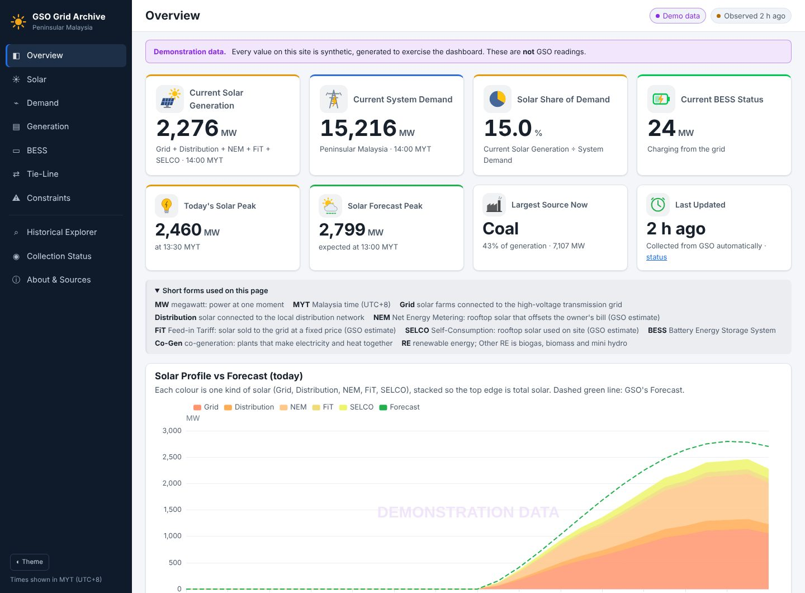

# ☀️ GSO Grid Archive

**A permanent record of Peninsular Malaysia's electricity grid, with solar power front and centre.**

*Collects the Grid System Operator's public data every few minutes, keeps every reading forever, and turns it into charts, tables and downloads that update themselves.*

## What it is

- **Solar first**, straight from [GSO's Solar page](https://www.gso.org.my/SystemData/Solar.aspx): grid (transmission) solar, distribution solar, and NEM, FiT and SELCO rooftop solar (GSO's own estimates), with GSO's solar forecast to compare against. Plus daily peaks and when they happened, energy per day, how fast output rises and falls, solar's share of demand, and day / week / month / year comparisons.
- **Every large solar farm**: live output and capacity of the 60 or so solar farms on GSO's solar map, with state, region and grid or distribution connection.
- **The rest of the grid too**: system demand, generation by fuel (coal, gas, hydro, solar, co-generation, oil), other renewables, total generation, system availability, installed capacity, battery storage (BESS) charge and discharge, and the links to Thailand and Singapore.
- **Nothing is ever lost or overwritten**: if GSO changes a reading later, the new value is shown and the old one is kept. Gaps stay gaps. A missing reading is never shown as zero.
- **Collects by itself, often**: new readings about every 2–3 minutes. Several of GSO's pages only show *today*, so collecting all day long is what builds the history.
- **The page updates itself**: an open page checks for new readings every minute and redraws in place, keeping your dates, settings and scroll position. Your chosen view is kept in the page address, so a link shows exactly what you see.
- **No server, no database service**: GitHub Actions collects and GitHub Pages hosts the site, the same way as Tech Comparison Hub. The archive is one file carried from run to run, published with the site, and copied to a GitHub Release every day.
- **Download anything**: CSV for any chart, monthly CSV files, and the whole archive as one SQLite file.
- **Works everywhere**: phones from 320 px to big screens, light and dark, all times in Malaysia time (MYT).

## How current is it?

| Part | Updated |
|---|---|
| Solar (grid, distribution, rooftop estimates), forecast, solar farms, BESS, availability | About every 2–3 minutes. GSO publishes these every 10 minutes, for today only |
| Generation by fuel, system demand | About every 2–3 minutes (every 10 minutes at GSO); yesterday is re-checked every hour for corrections; missed days are fetched again automatically |
| Tie-lines | About every 2–3 minutes (every 30 minutes at GSO) |
| Installed capacity | Once a day |
| Backup of the whole archive | Once a day, to the `archive-backups` release |
| An open page | Checks for new readings every minute and updates itself |
| The site itself | Every visit checks for newer files, so an update shows on the next refresh |

GitHub sometimes starts scheduled runs late. For the pages that take a date, nothing is lost, because each
request returns the whole day. For the today-only pages, a long GitHub delay late in the evening could miss the
last few readings of that day. The site's **Auto** label shows the collection interval measured from recent runs.

## Where the data comes from

Every address used was checked first-hand from GitHub's servers on 28 October 2026, and each value's meaning was
taken from GSO's own page scripts (see [what is known and how](docs/SOURCE_INVESTIGATION.md)). The site's Status
page shows when each source last worked. GSO doesn't publish system-constraints data, so that page says so instead
of guessing. Collection is on; to pause it, set the repository variable `GSO_LIVE_ENABLED` to `false`
(Settings → Secrets and variables → Actions → Variables). GSO's terms of use apply to the data. Another project
reports they require TNB's written consent to download or store it, so it's worth checking them on gso.org.my.

## Open it

Click **[OPEN THE SITE](https://darren38.github.io/gso-data-archive/)** above. It works in any browser on a phone,
tablet or computer, with nothing to install and no sign-up, and it keeps itself up to date while it's open.

More: [what is known about GSO's data](docs/SOURCE_INVESTIGATION.md) · [design and data model](docs/ARCHITECTURE.md) ·
[status and next steps](docs/STATUS.md) · [what changed and when](CHANGELOG.md) · [for developers](docs/DEVELOPMENT.md)

## Credits and licence

The code is under the [MIT licence](LICENSE). The data belongs to the Grid System Operator (GSO) / Tenaga Nasional
Berhad. This is an independent archive, not affiliated with or endorsed by GSO or TNB. Charts use
[Apache ECharts](https://echarts.apache.org/) (Apache 2.0, included in `web/vendor`).
