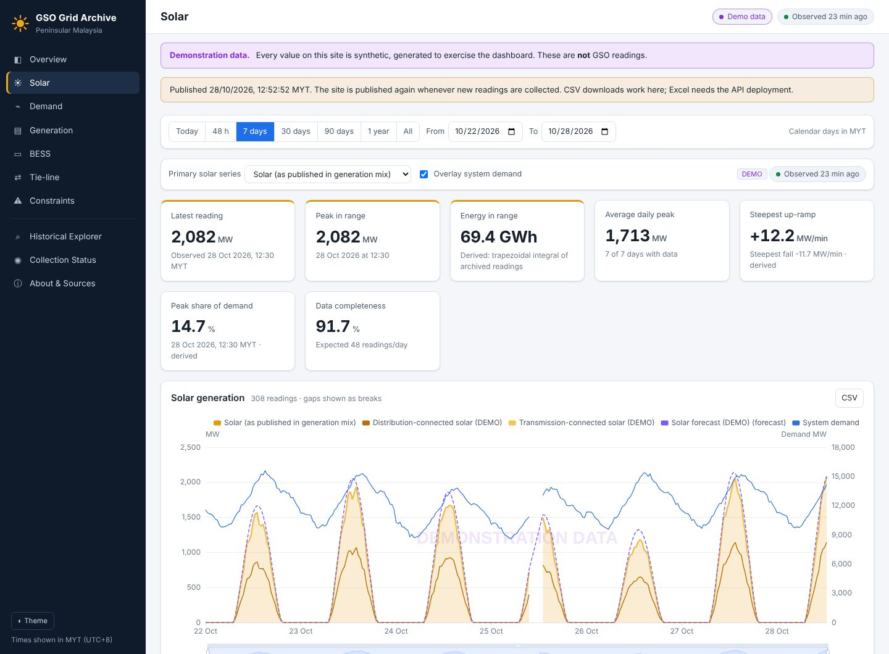

<div align="center">

# ☀️ GSO Grid Archive — Version 2

**A permanent record of Peninsular Malaysia's electricity grid, with solar power front and centre.**

*Collects the Grid System Operator's public data every 5 minutes, keeps every reading forever, and turns it into charts, tables and downloads.*

[](https://darren38.github.io/gso-data-archive/)

<a href="https://darren38.github.io/gso-data-archive/"></a>

</div>

## What it is

- **Solar first**: solar generation over any period, daily peaks and when they happened, energy per day (worked out from the readings), how fast output rises and falls, solar's share of demand, average daily shape, and day / week / month / year comparisons.
- **The rest of the grid too**: system demand, generation by fuel (coal, gas, hydro, solar, co-generation, oil), installed capacity, and the links to Thailand and Singapore.
- **Nothing is ever lost or overwritten**: if GSO changes a reading later, the new value is shown and the old one is kept. Gaps stay gaps. A missing reading is never shown as zero.
- **Collects by itself**: every 5 minutes. Yesterday is checked again every hour for late or corrected readings, and days that were missed are fetched again automatically.
- **No server, no database service**: GitHub Actions does the collecting and GitHub Pages hosts the site, the same way as Tech Comparison Hub. The archive is one file carried from run to run, published with the site, and copied daily to a GitHub Release.
- **Download anything**: CSV for any chart, monthly CSV files, and the whole archive as one SQLite file.
- **Honest about sources**: every dataset says how sure we are of it: seen first-hand, documented by another project, or still unverified. The Status page shows when each source last worked.
- **Works everywhere**: phones from 320 px to big screens, light and dark, all times in Malaysia time (MYT).

## How current is it?

| Part | Updated |
|---|---|
| New readings | Automatically, about every 5 minutes (GitHub sometimes runs it later; nothing is lost, because each request returns the whole day) |
| Yesterday's late or corrected readings | Checked again about once an hour |
| Days the collector missed | Fetched again automatically, up to 7 days back (older days with `backfill`) |
| Installed capacity | Once a day |
| Backup of the whole archive | Once a day, to the `archive-backups` release (last 14 days, plus the 1st of every month kept for good) |
| The site itself | Every visit checks for newer files, so an update shows on the next refresh |

## Before switching on collection

Automatic collection is **off until you switch it on**. Another project reports that GSO's terms
say its data may not be downloaded or stored without TNB's written consent. That text couldn't be
read first-hand from here, so please check the terms on [gso.org.my](https://www.gso.org.my/) and
ask GSO/TNB for consent if needed. Then switch collection on: **Settings → Secrets and variables →
Actions → Variables → New variable** `GSO_LIVE_ENABLED` = `true`.

Until then the site shows **demonstration data**: made-up curves, watermarked on every chart and
labelled on every page, so they can't be mistaken for GSO readings.

## Publishing the site (one time)

1. Merge into `main`.
2. **Settings → Pages → Build and deployment → Source: GitHub Actions**.
3. **Actions → "Collect and publish" → Run workflow**. After that it runs by itself every 5 minutes.

If a run fails (the site doesn't load, or collection stops), GitHub marks it red and emails you.

## Run it locally

Needs Python 3.11 or newer.

```bash
cd "Version 2"
pip install -r requirements.txt
python -m gso_archive seed-demo
DATABASE_URL="sqlite:///$PWD/data/demo.sqlite3" python -m gso_archive serve
```

Then open http://127.0.0.1:8000 (demonstration data). Run the tests with `python -m pytest`.

Other commands: `collect` (one round of collection), `schedule` (collect every 5 minutes on your own
computer or server), `backfill --start YYYY-MM-DD` (older days), `status`, `probe` (look at GSO's
pages to confirm how they serve data), `backup` / `restore-portable`. All are run as
`python -m gso_archive <command>`.

## Where the data comes from

The GSO website loads its charts by asking its own server for one day of readings at a time. The
addresses and field names come from the open-source [Electricity Maps](https://github.com/electricitymaps/electricitymaps-contrib)
project's GSO reader. This project hasn't been able to see them first-hand yet: the computer it was
built on can't reach gso.org.my. The **solar** figures are the `Solar` column of GSO's
generation-by-fuel data. The separate Solar Profile page and **BESS** and **system constraints** data
still need to be confirmed (`probe` does that), and their pages say "not available" rather than guessing.

Full details: [what is known and how](docs/SOURCE_INVESTIGATION.md) · [design and data model](docs/ARCHITECTURE.md) ·
[deployment options](docs/DEPLOYMENT.md) · [backups](docs/BACKUP_RESTORE.md) · [status and next steps](docs/STATUS.md) ·
[changelog](../CHANGELOG.md)

## What's new in Version 2

- Runs completely on GitHub, with no server or database service to pay for. Version 1 needed one of those to keep collecting.
- The whole archive can be downloaded from the site, and a copy goes to a GitHub Release every day.
- A check-up after every update emails you if the site or the collection breaks. The schedule keeps itself switched on.
- "Auto" labels say how often the data updates, and every visit loads the newest version of the site.
- Fixed: on a 320 px phone the Solar page's controls stuck out sideways. Chart axis titles no longer overlap the legend.

## Credits and licence

The code is under the [MIT licence](../LICENSE). The data belongs to the Grid System Operator (GSO) /
Tenaga Nasional Berhad. This is an independent archive, not affiliated with or endorsed by GSO or TNB.
Charts use [Apache ECharts](https://echarts.apache.org/) (Apache 2.0, included in `web/vendor`).
